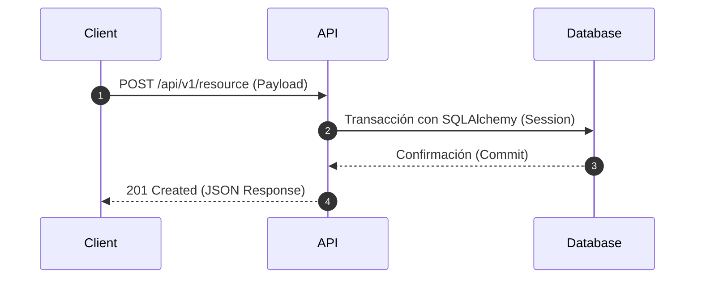

# [Nombre del Proyecto] 🚀

> Breve descripción de 1 línea explicando qué problema técnico o de negocio resuelve este backend.

[](https://tu-servicio.onrender.com/docs)
[](https://python.org)
[](#)

---

## 📋 Tabla de Contenidos
- [Arquitectura & Flujo](#arquitectura--flujo)
- [Stack Tecnológico](#stack-tecnológico)
- [Endpoints Principales](#endpoints-principales)
- [Decisiones Técnicas Clave](#decisiones-técnicas-clave)
- [Puesta en Marcha Local](#puesta-en-marcha-local)
- [Variables de Entorno](#variables-de-entorno)

---

## 📐 Arquitectura & Flujo



---

## 🛠️ Stack Tecnológico
* **Framework:** FastAPI (Python 3.11+)
* **ORM:** SQLAlchemy 2.0 (Modo Síncrono)
* **Driver de BD:** psycopg2-binary
* **Base de Datos:** PostgreSQL
* **Migraciones:** Alembic
* **Testing:** Pytest & HTTPX
* **Contenerización:** Docker

---

## 🛣️ Endpoints Principales

| Método | Ruta | Descripción | Auth |
| :--- | :--- | :--- | :---: |
| `POST` | `/api/v1/auth/login` | Emisión de Access y Refresh Token | No |
| `GET` | `/api/v1/recurso` | Lista paginada con filtros | Sí |
| `POST` | `/api/v1/recurso` | Creación atómica del registro | Sí |
| `GET` | `/health` | Chequeo de conexión con la base de datos | No |

---

## 🧠 Decisiones Técnicas Clave

1. **[Decisión 1, ej: Bloqueo Pesimista en DB]:**
   * *Problema:* Dos peticiones simultáneas podían generar inconsistencias en los datos.
   * *Solución:* Implementación de `with_for_update()` en SQLAlchemy para garantizar transacciones atómicas seguras.
2. **[Decisión 2, ej: Manejo de Sesiones Síncronas]:**
   * *Problema:* Necesidad de un control de transacciones limpio y predecible.
   * *Solución:* Inyección de dependencias `get_db` con context manager para apertura y cierre automático de la sesión de PostgreSQL.

---

## 💻 Puesta en Marcha Local

### Prerrequisitos
* Python 3.11+
* PostgreSQL local o en la nube (ej. Neon / Supabase / Render)

### Pasos
1. **Clonar el repositorio:**
   ```bash
   git clone https://github.com/tu-usuario/nombre-proyecto.git
   cd nombre-proyecto
   ```
2. **Crear y activar entorno virtual:**
   ```bash
   python3 -m venv venv
   source venv/bin/activate  # En Linux/Mac
   ```
3. **Instalar dependencias:**
   ```bash
   pip install -r requirements.txt
   ```
4. **Configurar variables de entorno:**
   ```bash
   cp .env.example .env
   # Edita .env con tu cadena de conexión PostgreSQL real
   ```
5. **Ejecutar migraciones:**
   ```bash
   alembic upgrade head
   ```
6. **Iniciar servidor de desarrollo:**
   ```bash
   uvicorn app.main:app --reload
   ```
7. Visita la documentación interactiva en: `http://localhost:8000/docs`

---

## 🧪 Ejecución de Tests
```bash
pytest -v
```
